# Telco Customer Churn — End-to-End Analysis

> Generated automatically by `python run.py all` on the IBM Telco Customer Churn
> sample extract. Every number below is produced by the pipeline, not hand-written.

## 1. Executive summary

- **Dataset:** 7,043 customers,
  22 raw columns.
- **Target:** `Churn`, with a **26.5%** positive rate — an imbalanced
  classification problem where naive accuracy is a misleading metric.
- **Best model:** `logistic_regression`, tuned with a randomised
  search and a decision threshold optimised on out-of-fold predictions.
- **Hold-out performance:** ROC AUC **0.845**, average
  precision **0.652**, F1 **0.624**
  at threshold **0.60**.
- **Primary churn drivers:** contract type, tenure, monthly charges and the absence
  of support/security add-ons.

## 2. Dataset and validation

Source: IBM's public Telco customer churn extract (Telco-Customer-Churn.csv).
The pipeline verifies 9 schema checks before any
modelling step, so a corrupted or reordered download fails fast instead of silently
poisoning results.

## 3. Cleaning

| Step | Result |
| --- | --- |
| Rows in | 7,043 |
| Duplicate customer IDs removed | 0 |
| Rows with missing target dropped | 0 |
| `TotalCharges` zero-filled | 11 |
| Remaining nulls after imputation | 0 |
| Rows out | 7,043 |

The only systematic data-quality defect is `TotalCharges`: it is stored as text and
blank for customers with `tenure == 0`. Those rows are genuinely zero-billing rather
than corrupt, so they are imputed with `0.0` and documented instead of dropped.

## 4. Exploratory findings

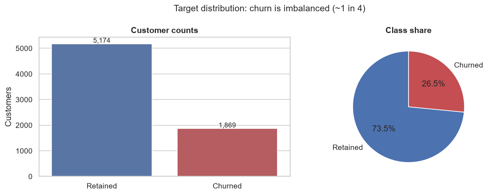

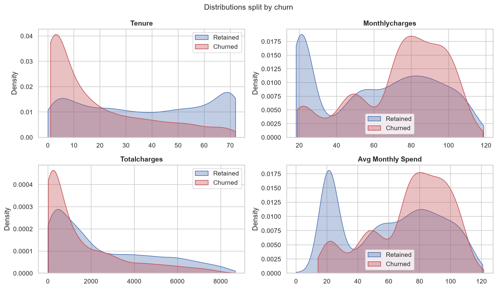

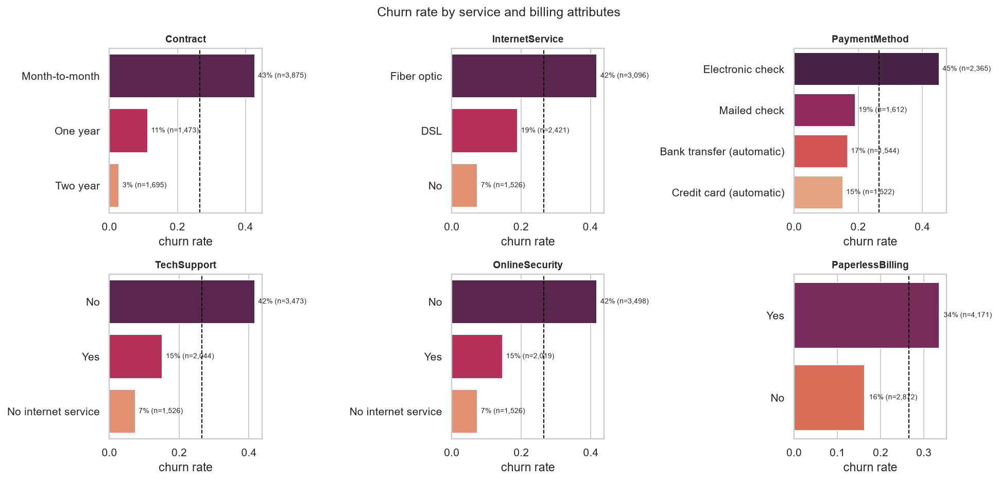

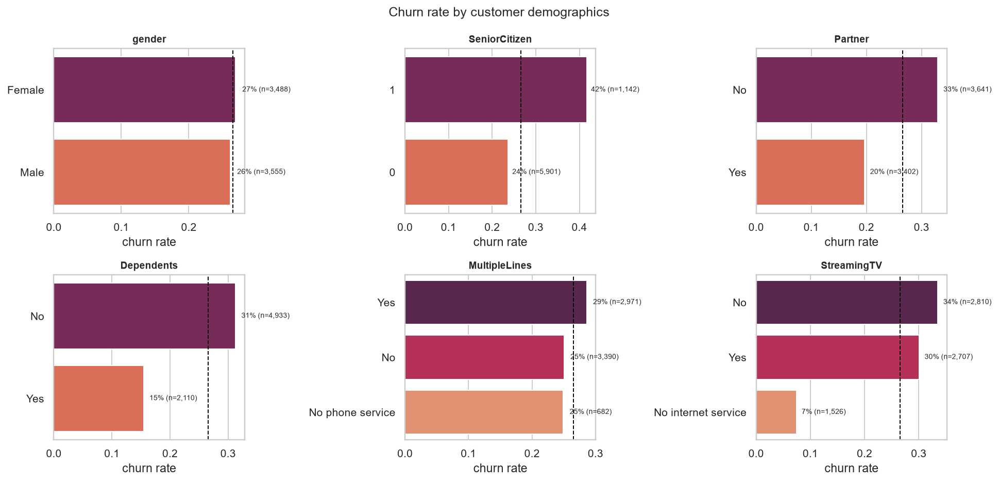

### Contract type is the strongest structural signal

| Contract | Churn rate | Customers |
| --- | --- | --- |
| Month-to-month | 42.7% | 3,875 |
| One year | 11.3% | 1,473 |
| Two year | 2.8% | 1,695 |

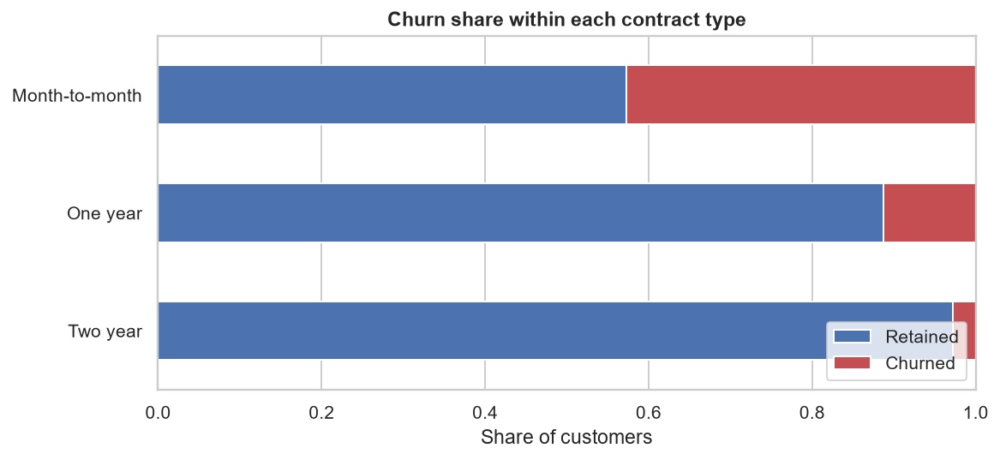

### Churn is front-loaded

Median tenure is **38 months for churners** versus
**10 months for retained customers**. The first year is the
highest-risk window.

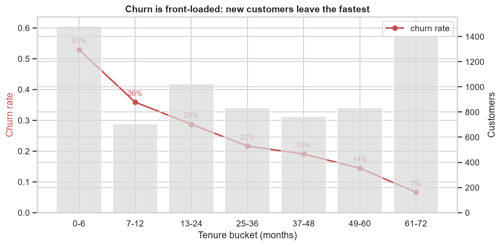

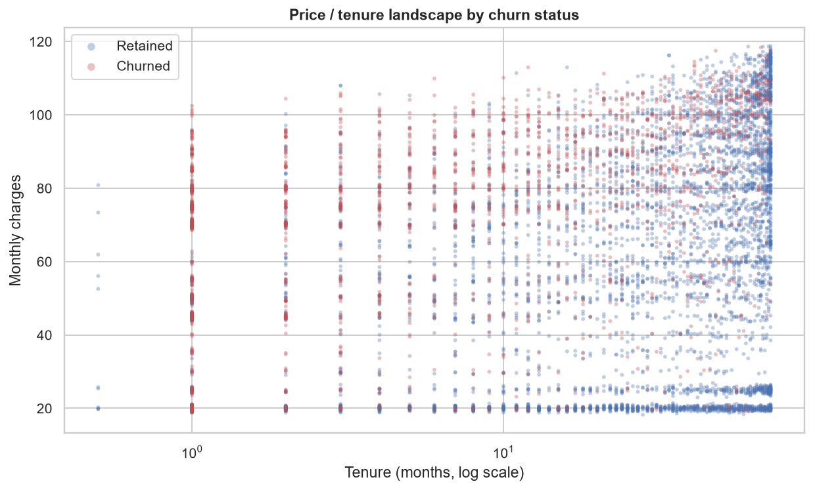

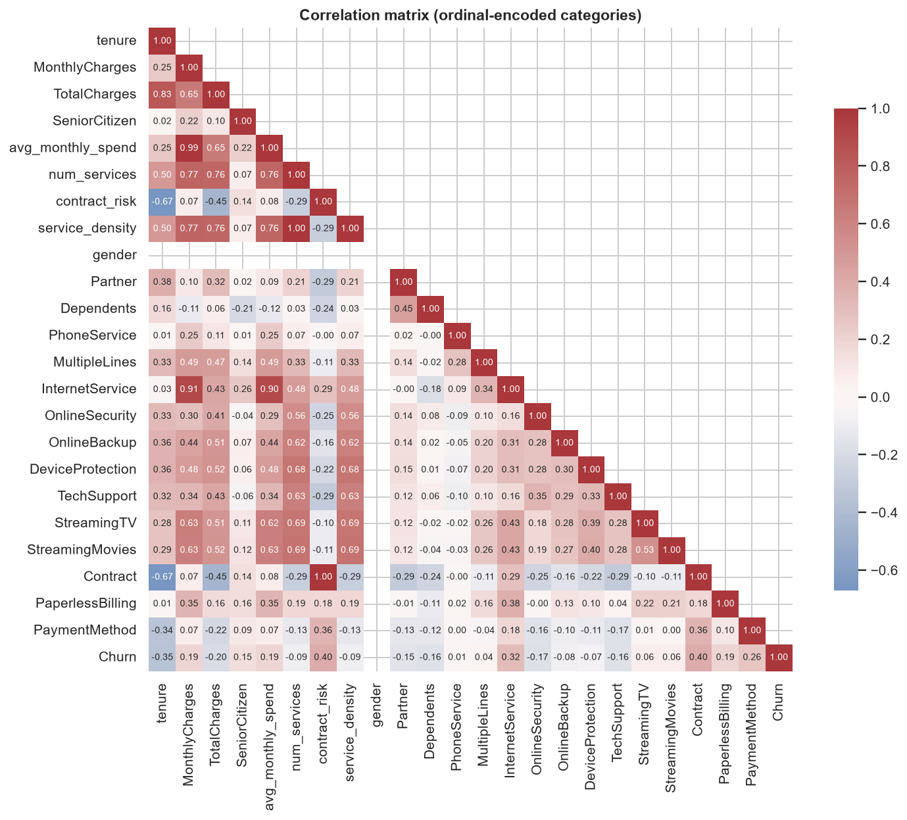

### Strongest correlations with churn

| Feature | Correlation |
| --- | --- |
| `Contract` | +0.397 |
| `contract_risk` | +0.397 |
| `tenure` | -0.352 |
| `InternetService` | +0.317 |
| `PaymentMethod` | +0.263 |
| `TotalCharges` | -0.198 |
| `MonthlyCharges` | +0.193 |
| `avg_monthly_spend` | +0.193 |
| `PaperlessBilling` | +0.192 |
| `OnlineSecurity` | -0.171 |

## 5. Modelling

### 5.1 Candidate comparison (5-fold stratified CV on the training split)

| Model | ROC AUC | Avg. precision | F1 | Recall | Fit time |
| --- | --- | --- | --- | --- | --- |
| logistic regression | 0.847 | 0.659 | 0.632 | 0.801 | 0.6s |
| gradient boosting | 0.846 | 0.659 | 0.581 | 0.518 | 8.2s |
| random forest | 0.841 | 0.646 | 0.625 | 0.671 | 4.4s |

Model families span a regularised linear baseline and two tree ensembles, so the
comparison isolates the value of non-linear interactions rather than just tuning one
algorithm.

### 5.2 Final configuration

- Selected family: **`logistic_regression`**
- Best parameters: `{"C": 2.7964859516062464, "solver": "lbfgs"}`
- Decision threshold: **0.60**
  (maximise F1 on 5-fold out-of-fold probabilities)
- Search cost: 7.9 s — end-to-end training
  43.7 s.

### 5.3 Hold-out test performance

| Metric | Value |
| --- | --- |
| ROC AUC | 0.8448 |
| Average precision | 0.6519 |
| Accuracy | 0.7715 |
| Precision | 0.5539 |
| Recall | 0.7139 |
| F1 | 0.6238 |
| Brier score | 0.1660 |
| True positives | 267 |
| False negatives | 107 |
| False positives | 215 |
| True negatives | 820 |

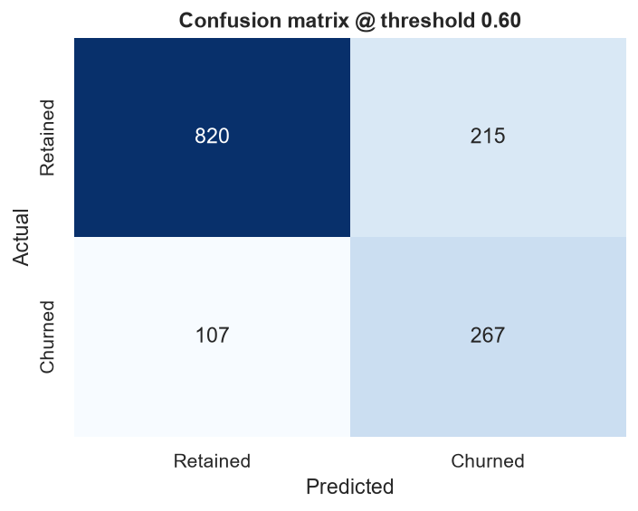

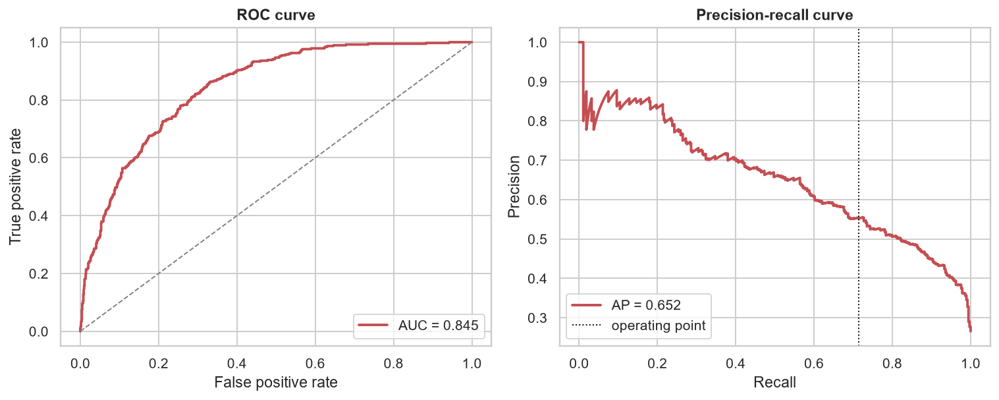

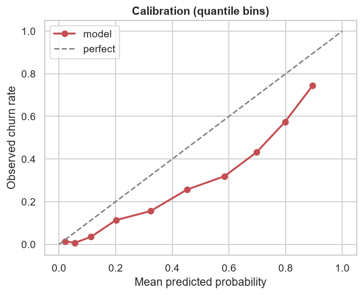

### 5.4 Choosing an operating point

Retention teams care about *how many true churners they can reach* per campaign.
Precision and recall trade off directly, so the threshold is a business decision, not
a modelling one:

| Threshold | Precision | Recall | F1 |
| --- | --- | --- | --- |
| 0.30 | 0.432 | 0.922 | 0.589 |
| 0.40 | 0.468 | 0.874 | 0.610 |
| 0.50 | 0.507 | 0.799 | 0.620 |
| 0.60 | 0.554 | 0.714 | 0.624 |

### 5.5 What drives the predictions

| Feature | Importance |
| --- | --- |
| `InternetService_Fiber optic` | 1.1761 |
| `InternetService_DSL` | 1.0320 |
| `MonthlyCharges` | 0.8021 |
| `avg_monthly_spend` | 0.7862 |
| `contract_risk` | 0.5005 |
| `is_new_customer_0` | 0.4680 |
| `service_density` | 0.3656 |
| `num_services` | 0.3656 |
| `OnlineSecurity_No` | 0.3213 |
| `is_new_customer_1` | 0.3168 |

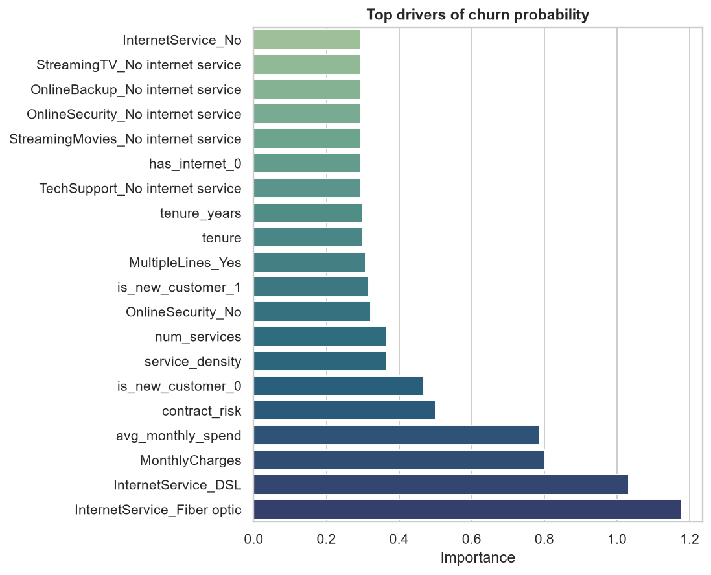

## 6. Interpretation

1. **Month-to-month contracts** churn several times more often than two-year
   contracts; contract risk is the single largest lever.
2. **New customers** (tenure ≤ 6 months) are the riskiest cohort, which argues for
   onboarding investment rather than broad discounting.
3. **Fiber-optic customers with high monthly charges and no tech-support/security
   add-ons** combine high price with low switching cost.
4. **Automatic payment** correlates with retention — friction in billing is a
   retention feature.

## 7. Limitations

- Observational snapshot, not causal: coefficients and importances describe
  association, not uplift.
- No temporal validation split; a production system should validate on a later
  cohort to detect drift.
- Class imbalance is handled with class weights and threshold tuning; SMOTE-style
  resampling was deliberately avoided to keep probability calibration honest.
- The dataset covers a single telecom provider and may not transfer.

## 8. Reproducing

```bash
pip install -r requirements.txt
python run.py all
```

`run.py all` downloads and validates the raw data, cleans it, regenerates every
figure in `reports/figures/`, trains and tunes the model, and rewrites this report
plus `reports/metrics.json` and `reports/model_card.md`.
